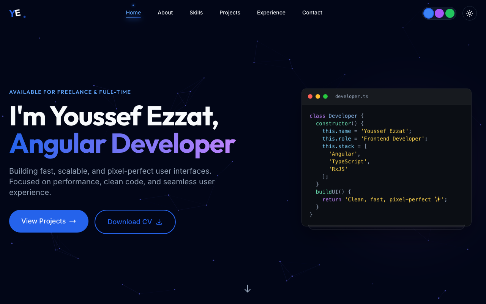

# 💫 About Me

💻 Motivated **MERN Stack Software Engineer** with a passion for building responsive and dynamic full-stack web applications.  
🛠️ Skilled in modern frontend and backend technologies such as **React.js, Angular, Next.js, Node.js, Express, MongoDB**.  
🅰️ Building modern **Angular** apps — standalone components, Signals, RxJS and Tailwind CSS (see the featured projects below).  
🤝 Team player with strong problem-solving skills and a focus on writing clean, maintainable code following best practices.  
🚀 Constantly exploring new tools, frameworks, and ways to improve performance and user experience.

---

## 🌐 Connect With Me

---

## ⭐ Featured Projects

<table>
  <tr>
    <td width="50%" valign="top">
      
    </td>
    <td valign="top">
      <h3>🅰️ Angular Lab</h3>
      A hands-on playground for learning Angular — 15 interactive lessons, each split into sections and closed by a quiz.  
      
      
      
      
      <ul>
        <li>Final quiz per topic: 6 random questions, 75% to pass</li>
        <li>Progress tracking and a dashboard with day streak and "Save for later"</li>
        <li>Light &amp; dark themes, command palette (⌘K), responsive with mobile bottom navigation</li>
        <li>Built with standalone components, signals and the new control flow (no NgModules); tested and deployed to GitHub Pages with GitHub Actions</li>
      </ul>
      <a href="https://youssefezzat17.github.io/angular-lab/"><b>🌐 Live demo</b></a> &nbsp;·&nbsp; <a href="https://github.com/YoussefEzzat17/angular-lab"><b>📦 Source code</b></a>
    </td>
  </tr>
  <tr>
    <td width="50%" valign="top">
      
    </td>
    <td valign="top">
      <h3>👨‍💻 Portfolio</h3>
      A premium, interactive personal portfolio built with Angular 18, TypeScript and Tailwind CSS.  
      
      
      
      
      <ul>
        <li>3D project carousel with detail modal</li>
        <li>Dark / light mode with 3 runtime color themes</li>
        <li>Scroll-aware navigation and reveal animations</li>
        <li>Validated contact form via EmailJS</li>
      </ul>
      <a href="https://youssef-ezzat.vercel.app/"><b>🌐 Live demo</b></a> &nbsp;·&nbsp; <a href="https://github.com/YoussefEzzat17/youssef-portfolio"><b>📦 Source code</b></a>
    </td>
  </tr>
</table>

---

## 💻 Tech Stack

**Languages**  

**Frontend**  

**Styling**  

**Backend & Tools**  

**Other Tools**  

---

## 📊 GitHub Stats

<table>
  <tr>
    <td>
      
    </td>
    <td>
      
    </td>
  </tr>
</table>

---

## 🧩 More Projects

### 🔹 [Movie App](https://moviereactsite.netlify.app/)
A modern React.js movie browsing app with dark theme, search functionality, image slider, and context-based state management.  
**Tech Stack**: React.js, React Router, Bootstrap, Context API

  
  
  
  

---

### 🔹 [Nextstore – Product Manager](https://next-crud-app.netlify.app/)
A full-stack Next.js 13 product management app with seamless CRUD operations, Material-UI design, RESTful API integration, and App Router-based architecture.  
**Tech Stack**: Next.js 13, MUI, RESTful API

  
  

---

### 🔹 [Yummy – Food Discovery App](https://youssefezzat17.github.io/Yummy/)
An elegant UI to discover delicious meals and recipes with responsive design and real-time search.  
**Tech Stack**: HTML5, CSS3, JavaScript, Bootstrap, jQuery

  
  

---

### 🔹 [Memory Game](https://memorygame-site.netlify.app/)
A browser-based game to test and improve short-term memory with card matching logic.  
**Tech Stack**: HTML5, CSS3, JavaScript

  
  

---

### 🔹 [Weather App](https://youssefezzat17.github.io/weather/)
Simple and clean 3-day forecast app that allows users to view weather data by country.  
**Tech Stack**: HTML5, CSS3, JavaScript

  

---

### 🔹 [VueStock – Product Management Dashboard](https://github.com/YoussefEzzat17/Vue-CRUD-Operations)
A dynamic product management dashboard with advanced routing, search, filtering, and real-time CRUD functionality.  
**Tech Stack**: Vue.js, Vuex, Axios, Bootstrap

---

### 🔹 [DevFolio – Personal Portfolio Website](https://youssefezzat17.github.io/Devfolio/)
A portfolio to showcase skills, projects, and contact info using modern HTML/CSS layout.  
**Tech Stack**: HTML5, CSS3, JavaScript, Bootstrap

  

---

<!-- Proudly created with GPRM (https://gprm.itsvg.in) -->
